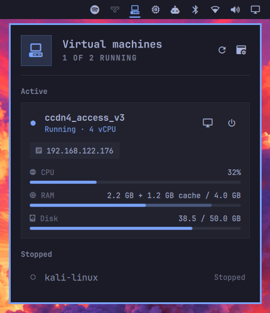
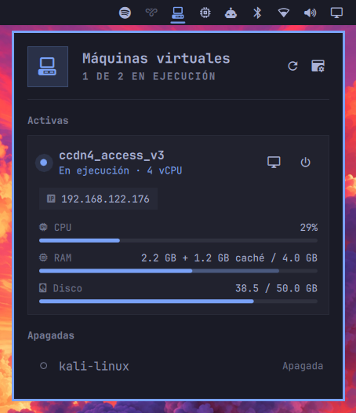

# omarchy-qemu-plugin

**[English](#english) · [Español](#español)**

---

## English



QEMU/libvirt VM manager widget for Omarchy. Monitor and control your virtual machines directly from the bar.

### Features

- Lists all VMs registered in libvirt, grouped into active and stopped
- Live CPU, RAM and disk meters for running VMs. RAM shows guest-reported usage plus reclaimable cache (like `htop`) when the virtio balloon driver is present, host RSS otherwise
- Click-to-copy IP address
- Start, graceful shutdown, force off (while a shutdown is pending) and resume paused VMs
- Shows transitional states ("Starting…", "Shutting down…")
- Opens the VM console when it starts, and closes it automatically when the VM shuts down (also when shut down from inside the guest)
- Failed actions are shown on the VM row and sent as a desktop notification with the reason
- Bar icon turns to the theme accent color while any VM is running; right-click opens virt-manager
- Follows the active Omarchy theme colors and corner style
- Works with any system locale

### Requirements

Omarchy does not ship QEMU or libvirt, and installing this plugin does not set them up. The plugin talks to libvirt (`qemu:///system`), so the host needs the libvirt service running and your user allowed to use it. If you already manage VMs with virt-manager without sudo, skip to [Installation](#installation).

One-time host setup (Arch / Omarchy), step by step:

1. Install QEMU, libvirt, virt-manager and the packages libvirt needs for VM networking and UEFI guests:

   ```bash
   sudo pacman -S --needed qemu-desktop libvirt virt-manager dnsmasq edk2-ovmf
   ```

2. Enable and start the libvirt service:

   ```bash
   sudo systemctl enable --now libvirtd.service
   ```

3. Allow your user to manage system VMs without sudo by adding it to the `libvirt` group:

   ```bash
   sudo usermod -aG libvirt $USER
   ```

   Log out and back in (or reboot) so the new group takes effect.

4. Start the default NAT network and make it start on boot:

   ```bash
   sudo virsh net-start default
   sudo virsh net-autostart default
   ```

   `net-start` reports an error if the network is already active; that is fine.

5. Check that it works **without** sudo. This must list your VMs (or an empty table), not a permission error:

   ```bash
   virsh -c qemu:///system list --all
   ```

`wl-clipboard` (for copying IPs) is already part of Omarchy.

### Installation

```bash
omarchy plugin add https://github.com/pacman-vzla/omarchy-qemu-plugin.git --enable
```

### Usage

Click the VM icon in the bar to open the panel (right-click opens virt-manager). Click a stopped VM to start it; its console opens once it is up. On a running VM, use the monitor button to open its console and the power button to shut it down gracefully; while it is shutting down the button turns into "Force off".

VMs can also be controlled from the terminal or a keybinding:

```bash
omarchy-shell dix.qemu start <vm>
omarchy-shell dix.qemu shutdown <vm>
omarchy-shell dix.qemu refresh
```

### Language

The panel follows the language set in Omarchy under Setup › Language, and changes as soon as you change it. All Omarchy languages are included.

### Sudo

Only the one-time host setup above uses sudo. The plugin itself never does: it uses `qemu:///system` through your `libvirt` group membership.

### Removal

```bash
omarchy plugin disable dix.qemu
omarchy plugin remove dix.qemu
```

---

## Español



Widget de Omarchy para administrar máquinas virtuales de QEMU/libvirt. Monitorea y controla tus VMs directamente desde la barra.

### Funciones

- Lista todas las VMs registradas en libvirt, separadas en activas y apagadas
- Barras en vivo de CPU, RAM y disco para las VMs encendidas. La RAM muestra el uso real dentro de la VM más la caché liberable (como `htop`) si la VM tiene el driver virtio balloon; si no, muestra lo que ocupa en el host
- Copia la IP con un clic
- Iniciar, apagar, forzar apagado (mientras se está apagando) y reanudar VMs en pausa
- Muestra estados intermedios ("Iniciando…", "Apagando…")
- Abre la consola de la VM al iniciarla y la cierra sola cuando la VM se apaga (también si se apaga desde dentro)
- Si una acción falla, se muestra en la fila de la VM y llega una notificación con el motivo
- El ícono de la barra toma el color de acento del tema cuando hay alguna VM encendida; con clic derecho abre virt-manager
- Usa los colores y el estilo de esquinas del tema activo de Omarchy
- Funciona con cualquier idioma del sistema

### Requisitos

Omarchy no trae QEMU ni libvirt, y instalar este plugin no los configura. El plugin se comunica con libvirt (`qemu:///system`), así que el equipo necesita el servicio de libvirt en ejecución y tu usuario con permiso para usarlo. Si ya administras VMs con virt-manager sin sudo, pasa directo a [Instalación](#instalación).

Configuración del equipo (una sola vez, Arch / Omarchy), paso a paso:

1. Instala QEMU, libvirt, virt-manager y los paquetes que libvirt necesita para la red de las VMs y para VMs UEFI:

   ```bash
   sudo pacman -S --needed qemu-desktop libvirt virt-manager dnsmasq edk2-ovmf
   ```

2. Habilita e inicia el servicio de libvirt:

   ```bash
   sudo systemctl enable --now libvirtd.service
   ```

3. Agrega tu usuario al grupo `libvirt` para administrar las VMs del sistema sin sudo:

   ```bash
   sudo usermod -aG libvirt $USER
   ```

   Cierra sesión y vuelve a entrar (o reinicia) para que el grupo nuevo tenga efecto.

4. Inicia la red NAT por defecto y haz que arranque con el sistema:

   ```bash
   sudo virsh net-start default
   sudo virsh net-autostart default
   ```

   Si la red ya estaba activa, `net-start` muestra un error; no pasa nada.

5. Comprueba que funciona **sin** sudo. Debe listar tus VMs (o una tabla vacía), no un error de permisos:

   ```bash
   virsh -c qemu:///system list --all
   ```

`wl-clipboard` (para copiar IPs) ya viene con Omarchy.

### Instalación

```bash
omarchy plugin add https://github.com/pacman-vzla/omarchy-qemu-plugin.git --enable
```

### Uso

Haz clic en el ícono de VM de la barra para abrir el panel (clic derecho abre virt-manager). Haz clic en una VM apagada para iniciarla; su consola se abre cuando arranca. En una VM encendida, el botón del monitor abre la consola y el botón de encendido la apaga de forma ordenada; mientras se apaga, ese botón cambia a "Forzar apagado".

También se pueden controlar desde la terminal o con un atajo de teclado:

```bash
omarchy-shell dix.qemu start <vm>
omarchy-shell dix.qemu shutdown <vm>
omarchy-shell dix.qemu refresh
```

### Idioma

El panel sigue el idioma configurado en Omarchy en Setup › Language, y cambia en cuanto lo cambias. Se incluyen todos los idiomas de Omarchy.

### Sudo

Solo la configuración inicial del equipo usa sudo. El plugin nunca lo usa: accede a `qemu:///system` gracias a que tu usuario está en el grupo `libvirt`.

### Desinstalación

```bash
omarchy plugin disable dix.qemu
omarchy plugin remove dix.qemu
```
